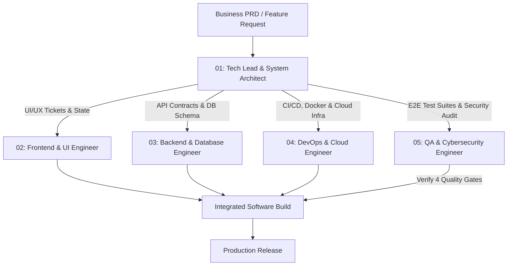

# 💻 Software Engineering Squad: ทีมวิศวกรและนักพัฒนาซอฟต์แวร์ 5 สายงาน

ชุด AI Agents ผู้เชี่ยวชาญด้านวิศวกรรมซอฟต์แวร์และการเขียนโค้ด ทำหน้าที่กระจายงานและทำงานร่วมกันตามบริบทของทีม (Role Context & Responsibility Distribution) เพื่อเปลี่ยนสเปกจากทีมบริหารให้ออกมาเป็นซอฟต์แวร์ที่ใช้งานได้จริง มีเสถียรภาพ และได้มาตรฐานระดับ Production

---

## 🏛️ โครงสร้างการแบ่งงานตามบริบทของทีม (Role & Work Distribution Matrix)

---

## 📋 รายนามทีมวิศวกรทั้ง 5 สายงาน

| # | Agent Identifier | บทบาท & ตำแหน่ง | หน้าที่หลักและ Deliverables ที่สร้าง |
|---|---|---|---|
| **01** | `tech_lead_architect` | **Tech Lead & System Architect** | แปลง PRD เป็น System Architecture, ออกแบบ DB Schema, กำหนด API Contracts, และแตกงานแจกจ่ายทีมตามบริบท |
| **02** | `frontend_engineer` | **Senior Frontend & UI Engineer** | เขียนโค้ด UI Components (React 19 / TS / Tailwind), ระบบ State, Micro-interactions, Responsive ตามหลัก Anti-AI Slop |
| **03** | `backend_engineer` | **Senior Backend & DB Engineer** | พัฒนา REST/Serverless APIs, จัดการฐานข้อมูล (PostgreSQL/Netlify DB), Auth (OAuth/JWT), Rate Limiting |
| **04** | `devops_infra_engineer` | **Lead DevOps & Cloud Engineer** | เขียน GitHub Actions CI/CD, จัดการ Docker, Git Quality Hooks, Cloud Deployments, Uptime Monitoring |
| **05** | `qa_security_engineer` | **QA Automation & Security Engineer** | เขียน Unit/E2E Test (Playwright/Vitest), ตรวจสอบความปลอดภัย OWASP Top 10, ทำ Code Review และ Gatekeeper |

---

## 🚀 ตัวอย่างกระบวนการกระจายงาน (Contextual Delegation Flow)

เมื่อมี Feature ใหม่เข้ามา เช่น **"ระบบจัดการผู้ใช้และชำระเงินรายเดือน (Subscription System)"**:
1. **Tech Lead (`tech_lead_architect`):** กำหนด Flow การทำงาน, Schema ตาราง `users`, `subscriptions`, `invoices`, ออกแบบ API endpoints `/api/v1/billing/*` และสร้าง Ticket งาน 4 ใบ
2. **Frontend (`frontend_engineer`):** รับ Ticket UI สร้างหน้าตารางราคา, หน้ายืนยันการชำระเงิน, Modal แสดงสถานะ และ Toast Alert
3. **Backend (`backend_engineer`):** รับ Ticket API เขียน Endpoint เชื่อม Stripe Webhook, ตรวจสอบ Signature, จัดการ Transaction บันทึกลง Database
4. **DevOps (`devops_infra_engineer`):** รับ Ticket Infra ตั้งค่า Environment Secret (`STRIPE_SECRET_KEY`), เพิ่ม Healthcheck Route และตั้งค่า CI Pipeline
5. **QA (`qa_security_engineer`):** รับ Ticket Test เขียน E2E Test ทดสอบการชำระเงินผ่าน/ไม่ผ่าน, ทดสอบ Replay Attack บน Webhook และตรวจหา Memory Leak
